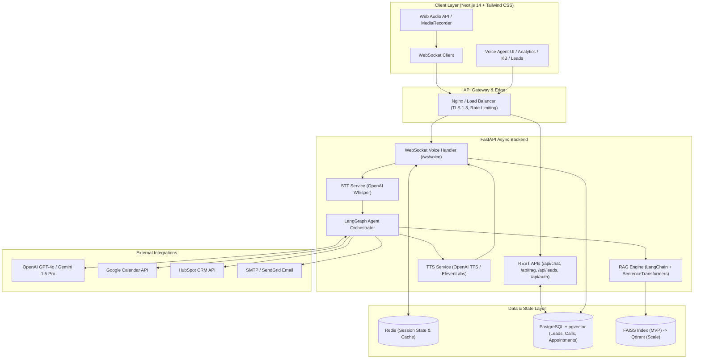

# SalesPilot AI — System Architecture, Scalability & Business Case

## 1. System Architecture Diagram

---

## 2. End-to-End Business Workflow

1. **Call Initiation**: Customer clicks *Start Call* in Next.js, opening a WebSocket (`/ws/voice/{session_id}?language=en`).
2. **Greeting**: Backend initializes `AgentState` in Redis, invokes LangGraph, synthesizes an audio greeting via TTS, and streams it to the browser.
3. **Voice Input & Interruption**: Customer holds the mic button (or interrupts AI playback) to speak. Browser sends WebM/Opus audio chunks over WebSocket.
4. **STT**: `transcribe_audio()` converts speech to text via Whisper.
5. **Agent Reasoning (LangGraph Loop)**:
   - `agent_node` evaluates intent and conversation history.
   - Calls `analyze_sentiment` on the customer message.
   - Calls `retrieve_product_info` (FAISS RAG) when product/pricing questions are asked.
   - Calls `qualify_lead_bant` as Budget, Authority, Need, or Timeline details emerge.
   - Calls `update_crm_contact` (HubSpot) when contact info is shared.
   - Calls `book_appointment` (Google Calendar + confirmation email) after explicit confirmation.
   - Calls `escalate_to_human` if requested or if negative sentiment/complexity warrants handoff.
6. **Voice Output & Live Insights**: `synthesize_speech()` returns MP3 audio; frontend plays it and updates the live BANT score card, sentiment badge, and CRM indicators.

---

## 3. Business Problem & Commercial Feasibility

- **Problem**: B2B sales teams lose 40–60% of inbound leads due to slow response times (>5 minutes) and spend ~65% of rep time on repetitive qualification and scheduling.
- **Solution**: SalesPilot AI responds in <2 seconds, qualifies leads using BANT, answers grounded product questions via RAG, and books meetings directly into HubSpot & Google Calendar 24/7 in multiple languages.
- **Commercial Feasibility**:
  - Target ACV: \$3,600 – \$30,000/year per B2B customer.
  - Gross Margin: ~70–78% at scale using tiered LLM routing (`gpt-4o-mini` for routine turns, `gpt-4o` for complex objection handling).

---

## 4. Scalability Strategy (Supporting 100,000 Users)

Assuming 100,000 registered users with ~5,000–10,000 Daily Active Users and ~500 concurrent voice sessions at peak:

1. **Stateless Compute & Horizontal Autoscaling**:
   - FastAPI pods run behind Kubernetes HPA (scaling on CPU + active WebSocket connections).
   - Zero in-memory session state: all `AgentState` lives in Redis Cluster.
2. **Vector Store Migration (FAISS -> Qdrant / pgvector)**:
   - Local FAISS works for single-node MVP.
   - For 100k users (multi-tenant knowledge bases), migrate to **Qdrant** (sharded by `tenant_id` payload filter) or **pgvector** with HNSW indexes.
3. **Audio & Async Offloading**:
   - Upgrade from chunked WebSocket upload to **WebRTC (LiveKit)** with Silero VAD for sub-500ms turn-taking latency.
   - Offload post-call summarization, CRM sync, and email notifications to **Celery / ARQ workers** backed by Redis.
4. **Database Scaling**:
   - PostgreSQL primary with PgBouncer connection pooling + read replicas for analytics queries.
   - Partition `messages` table by month.
5. **Caching**:
   - Cache frequent RAG query embeddings and TTS audio for standard greetings in Redis + CDN.

---

## 5. Data Security, Infrastructure & Operational Costs

### Security Controls
- **Authentication & Authorization**: JWT (HS256/RS256) with bcrypt password hashing; role-based access (`admin`, `agent`, `viewer`).
- **Transport & Storage**: TLS 1.3 for REST/WSS, AES-256 encryption at rest for Postgres/Redis/S3.
- **API Hardening**: SlowAPI rate limiting, strict CORS origins, Pydantic input validation, no secrets in code.
- **Compliance**: PII redaction in logs, configurable audio retention policy, GDPR delete-by-lead endpoint.

### Estimated Monthly Operational Cost (100k Users, ~50k Calls/mo, avg 3 min/call)
| Component | Specification | Est. Monthly Cost |
|-----------|--------------|-------------------|
| Kubernetes Compute (EKS/GKE) | 6–10x `c6i.xlarge` nodes (autoscaled) | \$950 |
| Managed PostgreSQL + Read Replica | db.r6g.large Multi-AZ | \$380 |
| Managed Redis Cluster | cache.r6g.large | \$180 |
| Managed Qdrant Vector DB | 3-node cluster | \$250 |
| LLM API (`gpt-4o-mini` + `gpt-4o` mix) | ~150M tokens/mo | \$450 |
| STT (Whisper / Deepgram streaming) | 150,000 audio mins/mo | \$645 |
| TTS (OpenAI `tts-1` / ElevenLabs) | ~15M chars/mo | \$225 |
| Load Balancer, S3 & Observability | Logs, metrics, audio archive | \$150 |
| **Total Estimated Monthly Cost** | | **~\$3,230 / mo** |
